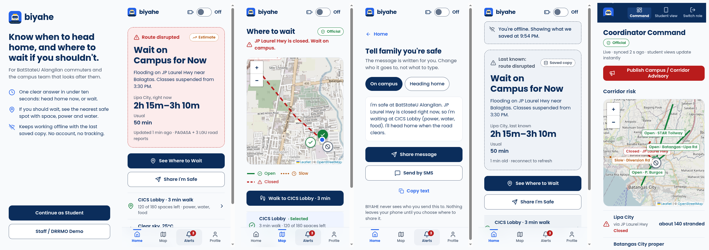

# BIYAHE

**Know when to head home, and where to wait if you shouldn't.**

A zero-input, offline-first disaster-commute PWA for BatStateU Alangilan, Pablo Borbon and JPLPC-Malvar. Students get one answer in under ten seconds. Campus staff and the DRRMO triage routes and safe spots in three clicks.



## Two flows

**Student (zero input, ≤10-second decision)**

`Welcome` → `1-step campus and route setup` → `Home`. Home says **Head Home Now** or **Wait on Campus for Now**, with the hazard-adjusted travel time against the usual one and a provenance badge (`Official`, `Estimate`, `Saved copy`). One tap from there:

- **See Where to Wait**: map and list of safe spots with live capacity, power / water / food, and walking time.
- **Share I'm Safe**: a pre-written family message (share sheet, SMS, or copy).
- **Alerts**: PAGASA, LGU and Campus advisories, filterable.
- **Profile & Offline**: offline storage status, Low-Battery Mode, demo scenario switcher.

**Staff / DRRMO (3-click triage)**

`Welcome` → `Staff / DRRMO quick access` → `Coordinator Command` (`#/coordinator`): route risk map, estimated stranded students per route (aggregated only, RA 10173), `−10 / +10` occupancy steppers and amenity toggles for each safe spot of the chosen campus, and a one-click **Publish Campus / Route Advisory** dialog that reaches student views immediately.

In the code and database a route is called a corridor (`Corridor`, `corridor_status`); the UI says "route".

## Campuses, routes and safe spots

The campus is chosen on the setup screen (students) or staff access screen, and kept on the device. Each campus lives in `src/campuses/<campus>.ts`.

| Campus | Routes |
|---|---|
| Alangilan | Lipa, Batangas City proper, Bauan / San Pascual, San Jose / Ibaan, Tanauan / Sto. Tomas |
| Pablo Borbon | Lipa, San Jose, Bauan / San Pascual, Ibaan / Rosario |
| JPLPC-Malvar | Lipa, Tanauan, Sto. Tomas, Batangas City |

Safe spots (Iteration 3). Coordinates are the project owner's values at full precision: owner-supplied map points, not an on-site survey. Capacity "not assessed" means no source supports a number yet; it is never guessed.

| Campus | Safe spot | Latitude | Longitude | Capacity |
|---|---|---:|---:|---:|
| Alangilan | Student Lounge | 13.78393267903075 | 121.07417575704717 | not assessed |
| Alangilan | Sparta Gymnasium | 13.784276340529747 | 121.07413074951742 | 1,030 |
| Alangilan | Einstein Bldg Library, 2nd Floor | 13.784168707874697 | 121.0749349027738 | 250 |
| Pablo Borbon | Felistiano "Sanoy" Leviste Multi-Purpose Gymnasium | 13.753079262668649 | 121.05277271784234 | 570 |
| Pablo Borbon | Main Library | 13.754549329790514 | 121.0525887000107 | 230 |
| JPLPC-Malvar | Gymnasium | 14.044572113490197 | 121.15574880496467 | not assessed |

- **Routes follow roads** in every build. Alangilan uses the reviewed OSRM run in `src/campuses/alangilan.preview.roads.ts`; Pablo Borbon and Malvar come from `npm run routes:campuses` (`scripts/build-campus-roads.mjs`, raw responses in `docs/routes/diagnostics/`). They are generated from OpenStreetMap and not checked on site; the map's **About routes** button says so.
- **Capacity** is usable floor area ÷ 2 m² per person (`SPOT_CAPACITY_RULE` in `src/campuses/index.ts`), since published figures are event seating. Sources for each spot are noted beside it in the campus file. The Malvar gym estimate was dropped because the owner's pin is ~125 m from the building it measured.
- **Names, positions and capacities belong to the app** (`src/campuses`). Saved copies, other tabs and Supabase rows supply only occupancy and amenities (`src/lib/spotData.ts`), so an old database or an old phone can never show a superseded name or coordinate.
- **Walking routes to a safe spot** (`src/lib/walkRoute.ts`) are labelled by where they came from: *Mapped route* (OpenStreetMap foot router, fetched now, 6 s timeout), *Saved route* (last mapped route for the same two points, kept in IndexedDB), *Estimate* (straight-line distance at 75 m/min, no line drawn), or *Unavailable*. None is checked on site. Offline and in Low-Battery Mode the app never calls the router.
- Not yet placed: the Malvar library (no public location found).

## Run the demo

```bash
npm install
npm run dev        # http://localhost:5173
```

1. Open the app in **two tabs**.
2. Tab A: **Continue as Student**, pick a route, stay on Home.
3. Tab B: **Staff / DRRMO Demo** → **Open Command Dashboard**.
4. In tab B press `+10` on a safe spot, toggle an amenity, or publish an advisory that sets a route to Closed. Tab A updates at once and announces the new advisory.
5. In tab A, **Profile → Demo scenario** switches between `Clear`, `Disrupted`, `Stale >30m`, `Offline Saved Copy` and `Low Battery`.

Each tab remembers its own role, so the two can sit side by side. Without Supabase the tabs sync through `BroadcastChannel`, so they must be in the same browser.

To check the installable, offline build:

```bash
npm run build && npm run preview   # http://localhost:4173
```

Load it once, then go offline and reload: the app shell comes from the service worker and the last snapshot from IndexedDB.

## Live data (optional)

The app runs on demo data with no configuration. To sync across devices:

1. Create a Supabase project and run [`supabase/schema.sql`](supabase/schema.sql) in the SQL editor (PostGIS tables, Realtime publication, demo RLS policies), then each file in [`supabase/migrations/`](supabase/migrations) in name order. The Iteration 3 migration renames the old Alangilan lobby row to `lounge`, writes the six canonical safe spots and is safe to re-run.
2. Copy `.env.example` to `.env.local` and fill in `VITE_SUPABASE_URL` and `VITE_SUPABASE_ANON_KEY`.
3. Restart `npm run dev`. Profile → Data connection shows which source is in use.

The write policies in the schema are open for the demo. Put them behind staff authentication before any real use.

| Source | Used for | Fallback |
|---|---|---|
| Supabase (PostgreSQL + PostGIS + Realtime) | Route status, safe spots, advisories | IndexedDB snapshot, fixtures in `src/data.ts` |
| Open-Meteo (13.7842, 121.0744) | Current weather | Last saved reading |
| PAGASA / Batangas City LGU | Advisory schemas (`PagasaAdvisory`, `LguAdvisory`) | Simulated fixtures; no live feed is wired |

## Brand

The logo is **Locator b** (team logo concepts canvas, "Minimal startup marks", concept 1): the bowl of the b is a "you are here" marker with the sun at its centre. `src/components/Logo.tsx` holds the mark and the stroked wordmark; `npm run icons` regenerates `public/favicon.svg`, the maskable icon and the PNGs from the same geometry (needs `rsvg-convert`).

## Updates, offline data and deep links

- The service worker (`vite-plugin-pwa`, `generateSW`, `autoUpdate`) activates new versions at once and reloads open pages one time (`src/lib/pwa.ts`, loop-guarded). The dev server removes any worker a previous `vite preview` left on its origin.
- IndexedDB is versioned (`src/lib/idb.ts`, now v2). Upgrades are targeted: v2 renames legacy safe-spot records and adds a `routes` store; weather, occupancy and advisories are kept.
- Routes use the hash (`#/map`). Path links such as `/map`, `/safespots` or `/coordinator` are rewritten on load; `vercel.json` serves `index.html` for them.
- **Profile → About this build** shows the commit, build time, whether Supabase is configured (present / missing, never the value), the walking router and data versions. Compare it between two machines first when one behaves differently.

## Design system

Tokens live in [`src/index.css`](src/index.css).

| Token | Value | Token | Value |
|---|---|---|---|
| `--deep` | `#0B2D5B` | `--ok` | `#147A3A` |
| `--sky` | `#2563EB` | `--warn` | `#B45309` |
| `--sun` | `#FBBF24` | `--danger` | `#B91C1C` |
| `--cloud` | `#F8FAFC` | `--slate` | `#64748B` |

Type is Poppins (self-hosted, precached) with tabular numerals.

- **Status never relies on colour.** Open = check icon + solid line, Slow = clock + dotted line, Closed = triangle + dashed line, each with a text label.
- **Provenance is always visible.** `Official` (solid outline), `Estimate` (dotted), `Saved copy` (dashed, neutral).
- **Layout.** 360–430px: single column with a glass bottom nav. ≥900px: sticky side rail with a split panel and map for both roles.
- **Low-Battery Mode.** Offered when the battery drops under 20%, or toggled in the header or Profile. Drops map tiles and animation, raises text contrast, polls less often.
- **Accessibility.** Skip link, 48px touch targets, native modal dialog with focus trap, `aria-live` toasts, `prefers-reduced-motion`.

## Stack

React + TypeScript (Vite), `vite-plugin-pwa`, Leaflet / react-leaflet with OpenStreetMap, `@supabase/supabase-js`, lucide icons.

```bash
npm run build    # tsc -b && vite build
npm run lint     # oxlint
```

BeansDev (Team 11) · CS Bootcamp: Build the Way Forward
