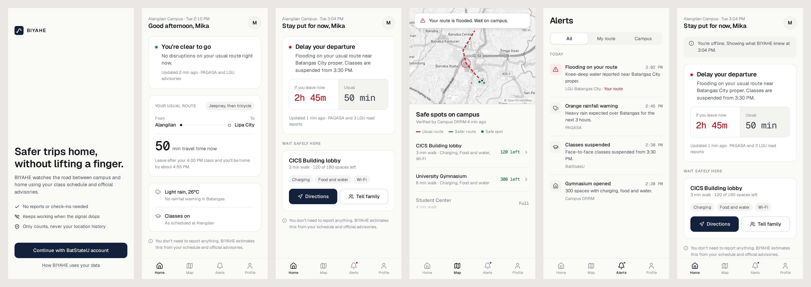

# BIYAHE

Safer trips home for BatStateU students. This is a minimalist redesign of the student mobile app, built as a Progressive Web App.



## Design direction

The redesign keeps the content and flows from the original Figma (*BIYAHE — Mobile App Redesign*) and simplifies the visual language:

- **One accent, one signal.** Navy `#14213D` is used only for primary actions. Red or green appears only as a small status dot or number when the state actually matters, never as a full-color card.
- **Neutral surfaces.** Off-white background, white cards with hairline borders, and no heavy shadows or tinted chips.
- **Type.** Geist for UI text and Geist Mono for times and durations, so numbers line up and read at a glance.
- **Lists over cards.** Alerts, safe spots and offline data use divided lists instead of stacked boxes.
- **Accessible defaults.** Text meets 4.5:1 contrast, focus rings are visible, touch targets are 48px, and `prefers-reduced-motion` is respected.

Design tokens are defined in [`src/index.css`](src/index.css).

## Screens

| # | Screen | Notes |
|---|--------|-------|
| 01 | Welcome | Sign-in with a BatStateU account |
| 02 | Home: clear | Usual route, live ETA, weather and class status |
| 03 | Home: disruption | Delay recommendation, travel-time comparison, nearest safe spot |
| 04 | Safe spots | Leaflet + OpenStreetMap, flooded route, safer route, capacity |
| 05 | Alerts | Filter by All, My route or Campus |
| 06 | Offline | Saved recommendation and cached data |

Use **Profile → Demo scenario** to switch between Clear, Disrupted and Offline.

## Stack

React + TypeScript (Vite), `vite-plugin-pwa` (service worker, offline cache, map-tile caching), Leaflet / react-leaflet with OpenStreetMap, and lucide icons. Campus and advisory data in `src/data.ts` is simulated for the MVP.

```bash
npm install
npm run dev      # http://localhost:5173
npm run build    # production PWA in dist/
```

BeansDev (Team 11) · CS Bootcamp: Build the Way Forward
