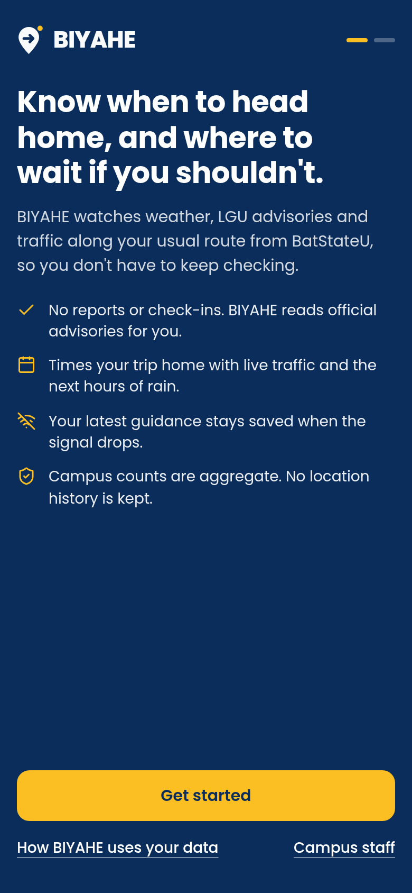
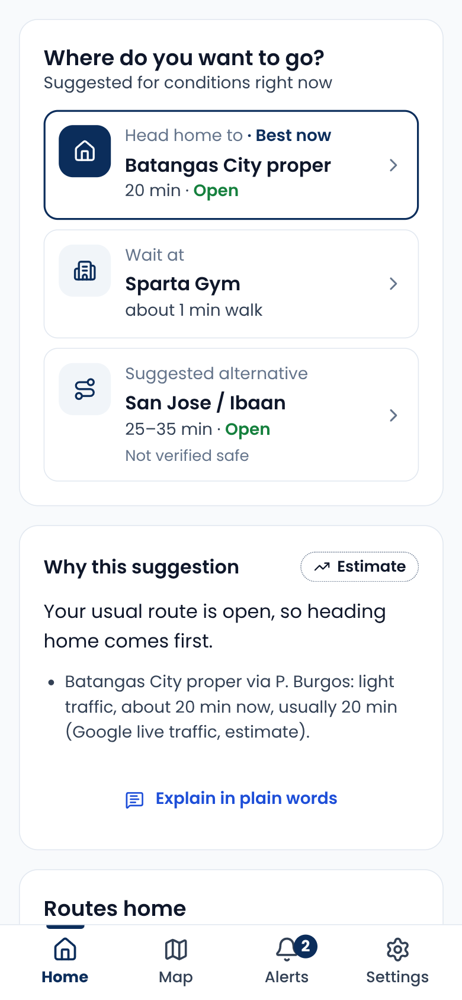
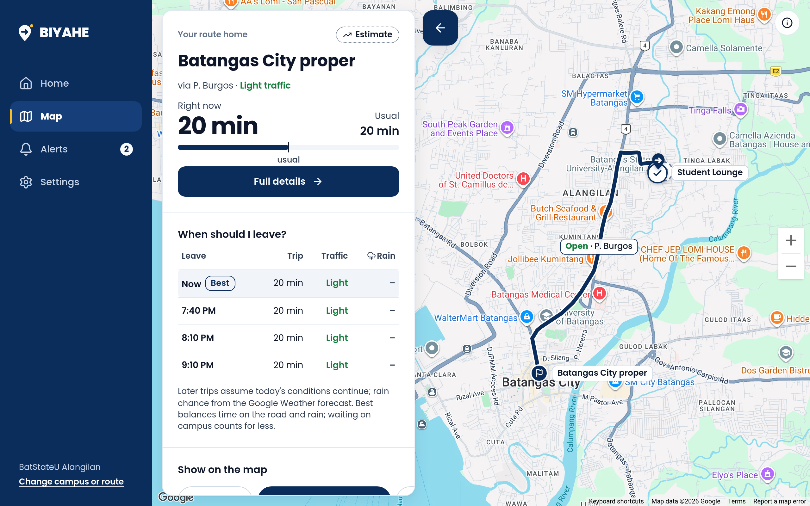
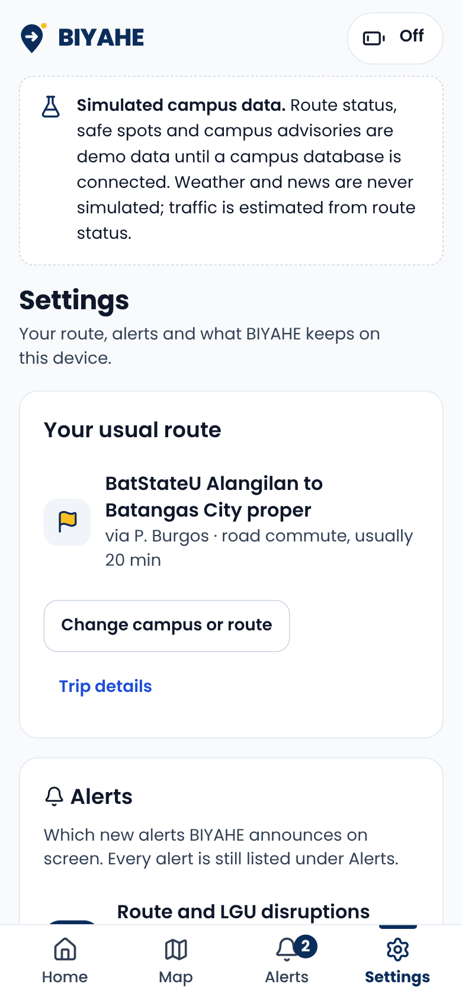

# BIYAHE — Project Documentation

**Safer journeys. Brighter tomorrows.**

BeansDev (Team 11) · CS Bootcamp: Build the Way Forward · Iteration 5 · 20 November 2026 (audit update
26 November 2026)

Live app: <https://biyahe-beansdev.vercel.app> · Repository: `PrinceJorick/BIYAHE` (branch `main`)

---

## 1. Overview

BIYAHE is an offline-first progressive web app (PWA) for commuting students of Batangas State University (Alangilan,
Pablo Borbon and JPLPC-Malvar campuses) and the campus teams who look after them during bad weather and disasters.

**The problem.** When a typhoon, flood or class suspension hits, thousands of students leave campus at once. They do
not know which roads are passable, how long the trip will take, or where to wait safely if they should not leave.
Campus disaster officers (DRRMO) have no quick way to tell them.

**What BIYAHE does.**

| For students (zero input, about ten seconds) | For staff and the DRRMO |
|---|---|
| One clear answer: *Head home now* or *Wait on campus for now*, with the trip time against the usual time | Route risk map and estimated stranded students per route (aggregate counts only, RA 10173) |
| Google Weather conditions, the chance of rain for the next hours and PAGASA public alerts | Occupancy steppers and amenity toggles for every safe spot |
| Traffic on their route (Google Routes, traffic-aware) and a "When should I leave?" plan | Campus advisories with a draft → publish → resolve lifecycle |
| Three suggested places to go, explained by the rule that chose them | A Batangas News & LGU Monitor of local weather reports to review before publishing |
| Alerts from PAGASA, the LGU and the campus, forecast and traffic notices and local weather news | Updates reach every open student view at once |
| A pre-written "I'm safe" message for family | |

**Principles.** Zero input after the one-time setup; offline first; every figure labelled with its source and time
(*Official*, *Estimate*, *Saved copy*, *Simulated*); a deterministic rule makes every recommendation and AI only
rewords it; no location tracking, no check-ins, no accounts for students.

---

## 2. Brand and design system

**Logo — "Go Pin".** A map pin holding a forward arrow, with the rising sun, on Deep Blue. The wordmark is BIYAHE in
Poppins ExtraBold. Geometry lives in `src/components/logoGeometry.ts`; the favicon and every PWA icon are generated
from the same values (`npm run icons`).

**Colour tokens** (`src/index.css`).

| Token | Hex | Use |
|---|---|---|
| `--deep` | `#0B2D5B` | Onboarding background, wordmark, active navigation, primary buttons |
| `--sky` | `#2563EB` | Links, focus rings, walking routes |
| `--sun` | `#FBBF24` | Logo sun, the onboarding action and step indicator, active-tab marker on the rail |
| `--cloud` | `#F8FAFC` | App background |
| `--ink` | `#0F172A` | Main text |
| `--ink-2` | `#334155` | Secondary text |
| `--slate` | `#64748B` | Labels and supporting text |
| `--line` | `#E2E8F0` | Borders and separators |
| `--ok` / `--warn` / `--danger` | `#15803D` / `#B45309` / `#B91C1C` | Status text only: low, medium, high |

Surfaces are flat white cards with a 1 px border. Red, amber and green appear only as text that reports a level, and
every level also has a word (route lines add a pattern: solid open, dotted slow, dashed closed). No gradients, no
decorative colour.

**Type.** Poppins only, tabular numerals everywhere. Display 28–38 px, H1 22–26 px, H2 18 px, body 16 px, meta
14 px, captions and labels 13 px (the minimum). Labels are sentence case. Headings balance their lines and body copy
avoids one-word last lines.

**Layout and access.** 4/8 px spacing, a 16 px gutter on phones, touch targets of at least 44 px, 3 px Sky focus
rings, reduced motion respected, no horizontal scrolling from 320 px up.

---

## 3. User flow

```
Welcome (step 1 of 2) ─► Setup: campus + route home (step 2 of 2)
                          │
                          ▼
   Home ──► Details (#/go/route/… or #/go/spot/…) ──► Map (#/map/…) ──► Share "I'm safe"
   Map · Alerts · Settings (tabs)
Staff:  Welcome ─► Campus staff ─► Coordinator Command
```

Navigation has four tabs: **Home, Map, Alerts, Settings**. On phones they are a bottom bar, fixed on every screen,
with the number of new or active alerts on Alerts. From 900 px they become a Deep Blue side rail. Each tab keeps its
own scroll position when you switch between tabs. Old links still work (`#/profile` opens Settings).

### 3.1 Welcome and Setup

| Welcome | Setup |
|---|---|
|  |  |

A two-step onboarding on Deep Blue with a step indicator. Welcome states what BIYAHE does and four plain promises
that match how the app works, with one action, **Get started**. *How BIYAHE uses your data* opens a privacy summary;
*Campus staff* leads to the staff flow. Setup asks the only question BIYAHE asks: campus and usual route home. It
stays on the device and can be changed from Settings.

### 3.2 Home

| Top of Home | Where do you want to go? |
|---|---|
|  |  |

1. **Context line** with the campus and route home.
2. **Urgent alert strip** when a critical advisory or one for the student's route is active.
3. **Weather**: live Google Weather conditions at the campus (temperature, sky, chance of rain and wind), the chance
   of rain for the next five hours, and a PAGASA warning when one is in force, labelled *Estimate* with the time of the
   reading. The browser asks Google directly with `VITE_GOOGLE_WEATHER_API_KEY` (checked working on 26 November 2026
   from the production site and from `localhost`). When Google cannot be reached the card shows the last reading as a
   *Saved copy* with its time; with no saved reading it says so and offers **Retry**; a build with no weather key
   says *Weather feed not configured for this build*.
4. **Traffic flow**: the level on the student's route, the trip time against the usual time, and the other routes.
5. **Today near your route**: one local weather headline, only when there is one, with *More local news*.
6. **Where do you want to go?**: three rows with the same layout. *Head home to* your route (marked *Best now* when it
   is open), *Wait at* the nearest safe spot with room, and a *Suggested alternative* route, always captioned *Not
   verified safe*. A closed route is never recommended.
7. **Why this suggestion**: the rule that chose the first option and the facts it used, each with its source.
   *Explain in plain words* asks Gemini to reword them (optional; the facts stay on screen).
8. **Routes home** and **Safe spots on campus**: every place with its trip time or walk and space left.

### 3.3 Details

| Head home | Wait on campus |
|---|---|
|  |  |

The answer first (*Head home now.* / *Expect delays.* / *Wait on campus for now.*), the route status and reason, the
trip time against the usual time, when it was updated and by whom, then traffic, notifications and the nearest places.
For a safe spot: the walk, space left, amenities and walking directions.

### 3.4 Map

| Map | Details open |
|---|---|
|  |  |

The map fills the screen above the bottom navigation. The place and its status sit in a chip at the top-left. When
a route line comes from OpenStreetMap (no live Google route for it yet), an info icon at the top-right explains how
it was made; with the Routes API the line is Google's own route and the icon is not needed. **Show details**, just above the navigation, drops
the details down over the top of the map:

- the destination with the trip time now against the usual time, and *Full details*;
- **When should I leave?**: now, in 30 minutes, 1 hour and 2 hours, with trip time, traffic and chance of rain, and
  the best window marked;
- **Show on the map**: every route and safe spot;
- **Map layers**: all routes, and Google live traffic.

On desktop the details are a panel on the left that starts open.



**Which map is shown.**

| Situation | Map |
|---|---|
| Online, Google key accepted | Google Maps (muted style or the cloud style of `VITE_GOOGLE_MAPS_MAP_ID`), with the live traffic layer and Google's route for each line (Routes API) |
| Online, no key or key rejected | The app's map over OpenStreetMap street tiles |
| Offline | The app's map over OpenStreetMap tiles saved on the device ("Offline: saved streets") |
| Low-Battery Mode | The app's plain map: route lines and pins on a dot grid, no tiles |

The OpenStreetMap credit is shown on the app's own map. Over Google's map it is not drawn on the map (Google credits
its own data); it appears in the route information dialog behind the info icon. Map labels try nearby spots before
they hide, and stay clear of pins, zoom buttons and other labels.

### 3.5 Alerts


Filters: All, PAGASA, LGU, Campus, Classes, Local news (with a count) and Forecast. Sections: advisories for the
student and their route, PAGASA weather warnings (from Google Weather public alerts, *Official*), forecast and traffic
notices worked out by BIYAHE (*Estimate*, never official), other routes, local weather news, and advisories that ended
in the last few hours. `#/alerts?filter=news` opens the Local news filter directly.

**Local news** comes from the Currents News API and is limited to **weather**: rain, storms and floods that name a
Batangas place. Each article shows the publisher and time (*Local news · Inquirer · 15m ago*) and opens the original
article. Offline, it opens the saved copy in a sheet instead. A news report is never labelled official.

### 3.6 Settings



Your usual route; which alerts BIYAHE announces (route and LGU disruptions, PAGASA warnings, class suspensions,
browser notifications while BIYAHE is open); offline data with the time of each source, **Sync now** and **Clear
offline data** (asks first); Low-Battery Mode; demo scenarios (marked *Simulated*, never written to the shared
database); privacy; build information; switching role.

### 3.7 Coordinator Command


Route risk map and list with estimated affected students per route, safe-spot occupancy and amenities, the advisory
lifecycle, and the **Batangas News & LGU Monitor** (the four latest local weather reports, marked as third-party
reports to check before publishing). Only the DRRMO Coordinator role can create, publish or resolve advisories;
Building Marshal and Guard on Duty see advisories read-only but can update safe-spot occupancy and amenities.

---

## 4. Data sources and APIs

| Source | What it gives | Key (where it lives) | Runs | Without it |
|---|---|---|---|---|
| **Google Maps JavaScript API** | Street map, live traffic layer | `VITE_GOOGLE_MAPS_API_KEY` (browser, restricted to the site) | Browser | OpenStreetMap or the plain map |
| **Google Routes API** (`computeRoutes`, traffic-aware) | Trip time now and free-flow, road geometry, forecasts for later departures | `VITE_GOOGLE_ROUTES_API_KEY` (browser; falls back to the Maps key) | Browser | Times estimated from route reports |
| **Google Weather API** | Current conditions, hourly forecast, PAGASA public alerts | `VITE_GOOGLE_WEATHER_API_KEY` (browser, website-restricted; falls back to the Maps key), else `GOOGLE_WEATHER_API_KEY` (server only) | Browser, else `/api/weather` | Last reading as a saved copy; with none, "Weather unavailable" and **Retry**; with no key at all, "Weather feed not configured for this build" |
| **Currents News API** | Local weather news | `CURRENTS_API_KEY` (server only, Bearer token) | `/api/news` | No news section |
| **Gemini** | Plain-language rewording of BIYAHE's own reason | `GEMINI_API_KEY`, `GEMINI_MODEL` (server only) | `/api/explain` | The rule and facts as they are |
| **Supabase** (PostgreSQL + Realtime) | Shared route status, safe spots, advisories | `VITE_SUPABASE_URL`, `VITE_SUPABASE_ANON_KEY` | Browser | Device data and cross-tab sync, marked *Simulated* |
| **OpenStreetMap tiles** | Street tiles for the app's map | none | Browser | Plain map |
| **OSRM foot router** (FOSSGIS) | Walking route to a safe spot | none (`VITE_WALK_ROUTER_URL` optional) | Browser | Saved route, then a straight-line estimate |

**Request limits and caching** (`src/lib/apiCache.ts`). Weather and Routes answers go through one cache: one request
per key in flight (simultaneous callers share it), a fresh-for window, a cooldown on manual refreshes, and the last
good answer as a fallback when a request fails.

| | Reused for | Manual refresh at most every | On 429 / 403 |
|---|---|---|---|
| Weather (per campus; the server also caches each Google endpoint) | 20 minutes | 60 seconds | Last good reading as a saved copy, no retry |
| Traffic-aware routes (per campus, destination, mode and departure) | 10 minutes | 30 seconds | Last good route, never shown as live after 20 minutes |
| Local news (server) | 30 minutes at the edge, 15 in memory | — | `Retry-After` honoured, no retry loop |

The app does not poll while the tab is hidden. Google Maps is created once per map screen and its routes, pins and
traffic update in place.

---

## 5. Setup and configuration

```bash
npm install
cp .env.example .env    # fill in the keys you have; .env is git-ignored
npm run dev             # http://localhost:5173
```

```ini
VITE_GOOGLE_MAPS_API_KEY=     # Maps JavaScript API (browser key, website-restricted)
VITE_GOOGLE_MAPS_MAP_ID=      # optional cloud-styled vector map
VITE_GOOGLE_ROUTES_API_KEY=   # optional separate Routes API browser key
CURRENTS_API_KEY=             # server only
VITE_GOOGLE_WEATHER_API_KEY=  # browser key; website restriction + API restriction: Weather API (else the Maps key)
GOOGLE_WEATHER_API_KEY=       # server only, used without a browser key; API restriction: Weather API; application restriction: none
GEMINI_API_KEY=               # server only, optional
GEMINI_MODEL=                 # optional, default gemini-2.5-flash
VITE_SUPABASE_URL=
VITE_SUPABASE_ANON_KEY=
# VITE_WALK_ROUTER_URL=       # optional own OSRM foot router; unset = FOSSGIS, empty = walking routes off
```

`VITE_*` values are compiled into the browser bundle and are public by design: restrict them to the site's domains
and to the APIs they need. The other keys never reach the browser. Weather is asked from the browser when the build
has `VITE_GOOGLE_WEATHER_API_KEY` (or a Maps key that also allows the Weather API): that key carries the site's
website restriction, and the request sends the page's `Referer`. Without one, `/api/weather` uses
`GOOGLE_WEATHER_API_KEY`, which must not carry a website restriction (server requests have no `Referer`; Google
answers 403). `VITE_*` values are fixed at build time: after changing one in Vercel, redeploy.

**Deploying (Vercel).** `vercel.json` sets the Vite framework, `npm run build` and the `dist` output, and sends every
non-API path to `index.html`. `api/news.ts`, `api/weather.ts` and `api/explain.ts` deploy as Vercel Functions. Set the
same variables under Project → Settings → Environment Variables (server keys as *Sensitive*).

---

## 6. Safe spots (waiting areas): verified coordinates

Coordinates are the project owner's values at full precision, each checked against OpenStreetMap on
19 November 2026.

| Campus | Safe spot | Latitude | Longitude | OpenStreetMap check |
|---|---|---:|---:|---|
| Alangilan | Student Lounge | 13.78393267903075 | 121.07417575704717 | Inside the campus, between the CICS building and Sparta Gymnasium |
| Alangilan | Sparta Gymnasium | 13.784276340529747 | 121.07413074951742 | Inside "Sparta Gymnasium" (way 489736297) |
| Alangilan | Einstein Bldg Library, 2nd Floor | 13.784168707874697 | 121.0749349027738 | Inside "Albert Einstein Building" (way 454854614) |
| Pablo Borbon | Felistiano "Sanoy" Leviste Multi-Purpose Gymnasium | 13.753079262668649 | 121.05277271784234 | Inside the gymnasium footprint (way 334825726) |
| Pablo Borbon | Main Library | 13.754549329790514 | 121.0525887000107 | Inside "Main Library" (way 489731778) |
| JPLPC-Malvar | Gymnasium | 14.044572113490197 | 121.15574880496467 | Inside a campus building footprint (way 350781586) |

Capacity is usable floor area ÷ 2 m² per person; "not assessed" means no source supports a number yet, and the app
then says the space is *not confirmed*.

---

## 7. Routes home

Each route is a road-following line from the campus to the town it is named after, generated from OpenStreetMap with
OSRM (`npm run routes:campuses`) and validated at runtime. With a Google key the map draws Google's route for the same
trip.

| Route (Alangilan) | Destination | Length | Main roads |
|---|---|---:|---|
| Lipa City | Lipa City Grand Terminal | 25.5 km | President Jose P. Laurel Highway |
| Batangas City proper | Poblacion, P. Burgos Street | 4.5 km | National Highway 4, P. Burgos Street |
| Bauan / San Pascual | Bauan Municipal Hall | 10.6 km | Batangas City–San Pascual–Bauan Bypass Road |
| San Jose / Ibaan | San Jose poblacion | 12.5 km | President Jose P. Laurel Highway |
| Tanauan / Sto. Tomas | Tanauan City Hall | 39.8 km | JP Laurel Highway, STAR Tollway |
| Rosario | Rosario Municipal Hall | 19.2 km | Batangas–Ibaan Road, Ibaan–Rosario Road |

| Route (Pablo Borbon) | Destination | Length | Main roads |
|---|---|---:|---|
| Lipa City | Lipa City Grand Terminal | 29.1 km | President Jose P. Laurel Highway |
| San Jose | San Jose poblacion | 16.2 km | President Jose P. Laurel Highway |
| Bauan / San Pascual | Bauan Municipal Hall | 7.9 km | National Highway 436 |
| Ibaan / Rosario | Rosario Municipal Hall | 22.9 km | Batangas–Ibaan Road, Ibaan–Rosario Road |
| Lemery / Taal | Lemery Municipal Hall | 30.3 km | National Highway 436, Batangas City–San Pascual–Bauan Bypass Road |

| Route (JPLPC-Malvar) | Destination | Length | Main roads |
|---|---|---:|---|
| Lipa City | Lipa City Grand Terminal | 11.0 km | President Jose P. Laurel Highway |
| Tanauan City | Tanauan City Hall | 7.8 km | STAR Tollway |
| Sto. Tomas | Santo Tomas Public Market | 7.7 km | President Jose P. Laurel Highway |
| Batangas City | Batangas City Grand Terminal | 35.0 km | President Jose P. Laurel Highway |
| Balete | Balete Municipal Hall | 9.0 km | Balete–Malvar Road |

Usual times for Pablo Borbon, Malvar and the added Alangilan route are the OSRM driving time × 1.8 + 5 minutes for
stops and waiting, rounded to 5. Commuter counts per route are simulated demo values.

### Route coverage review (26 November 2026)

No public data gives where BatStateU students live, so the review compared each campus's routes with the public
transport that serves it and with the 2020 census populations of the towns on each corridor.

| Campus | Gap found | Evidence | Decision |
|---|---|---|---|
| Alangilan | Rosario (128,352), the largest town with a direct jeepney but no route | Batangas City Grand Terminal (beside campus) – Rosario jeepney (BTG-J12 / BN-05); Supreme buses to Ibaan, Rosario and San Juan | Added **Rosario** |
| Pablo Borbon | The western corridor past Bauan: Lemery (93,186), Taal (61,460), San Luis (36,172) | Bauan – Lemery jeepney (BTG-J13); Batangas City – Lemery jeepney; BSC buses to Balayan and Nasugbu via Lemery | Added **Lemery / Taal** |
| JPLPC-Malvar | Balete (24,055), the only neighbouring town without a route | Balete – Malvar jeepney (BTG-J04) | Added **Balete** |
| Batangas City campuses | The eastern corridor: Taysan (40,146), Lobo (40,736) | Batangas City (SM) – Lobo jeepney (BTG-J10); Batangas City network BE | Not added: smaller than the corridors above; a candidate for the next review |

Sources: OpenStreetMap wiki, *Batangas/Public transportation* (revision of 28 May 2026); commutetour.com, *Batangas
City Grand Terminal* (updated 15 January 2026); Wikivoyage, *Batangas City*; PSA 2020 Census of Population and Housing
(as tabulated by batangashistory.date). Route lists are community-maintained and should be confirmed with the LGU or
LTFRB. Destinations were geocoded with OpenStreetMap Nominatim on 26 November 2026.

The added Alangilan route is outside the formal approval workflow (`docs/routes/approvals`), which covers the
original five; it must be added there before any reviewed route set is supplied.

---

## 8. Decision rules

| Rule | Value |
|---|---|
| Recommendation | Your route first when open or slow; the nearest safe spot with room first when it is closed; then the least-delayed other open route as a *Suggested alternative* |
| Source precedence | Official advisories decide route status; live traffic can only make an open route look worse; rain and weather warnings are shown as context and never close a route on their own |
| Traffic level from delay (traffic-aware ÷ free-flow) | Light < 1.25 ≤ Moderate < 1.6 ≤ Heavy |
| Live traffic counts as current for | 20 minutes |
| Data marked stale after | 30 minutes |
| Rain level | Low < 30% ≤ Medium < 60% ≤ High |
| Best departure | Least time on the road, rain counted as risk (+15 min for 30–59%, +40 min for 60%+), waiting on campus counted at a quarter |
| Walking time | Straight-line distance at 75 m per minute, always worded "about" |
| AI explanation | Gemini receives only the rule and facts; answers that call a route safe, add links or break the JSON shape are rejected |

---

## 9. Offline, storage and privacy

- The service worker precaches the app and fonts. IndexedDB keeps route status, safe spots and advisories, local news
  (24 hours), walking routes and which articles were opened. The weather and route cache (`localStorage`) keeps the
  last answers for up to 24 hours as saved copies.
- OpenStreetMap tiles the app shows are kept for a week (cache `osm-tiles`). Once a week, online, a small area around
  the campus and its routes is saved for the offline map: zoom 11–13, at most 200 tiles, within the OpenStreetMap tile
  usage policy.
- Offline, every screen still works from the saved copy and says so with its original time.
- Low-Battery Mode (suggested under 20%) uses the plain map, turns off animation and live traffic, and polls half as
  often.
- No location request, no background GPS, no account, no check-in. Staff see aggregate counts per route only
  (RA 10173). Settings → *Clear offline data* removes everything BIYAHE saved.

---

## 10. Architecture

React 19 + TypeScript (Vite 8), `vite-plugin-pwa`, Google Maps JavaScript API, Leaflet (the app's own map),
Supabase, Lucide icons, Vercel Functions.

| Path | Purpose |
|---|---|
| `src/App.tsx` | Shell, role rules, navigation, per-tab scroll memory |
| `src/screens/` | Welcome, Setup, Home, Destination (details), MapScreen, Alerts, Settings, Share, StaffAccess, Coordinator |
| `src/components/map/` | `MapView` (chooses the map), `GoogleMapView`, `SchematicMap` (OSM tiles or plain), pins, label placement |
| `src/components/NewsArticleRow.tsx` | One news article, online link or offline sheet |
| `src/lib/apiCache.ts` | Shared request cache: dedupe, TTL, cooldowns, fallbacks |
| `src/lib/googleRoutes.ts`, `src/lib/traffic.ts` | Routes API client, traffic levels, departure options |
| `src/lib/weather.ts`, `src/lib/googleWeather.ts` | Weather in the app (browser key, else `/api/weather`) and the shared Google Weather client used by both |
| `src/lib/news.ts`, `src/lib/explain.ts` | Clients for `/api/news`, `/api/explain` |
| `src/lib/places.ts` | Places, recommendations and their reasons |
| `src/lib/offlineTiles.ts` | Weekly save of OpenStreetMap tiles for the offline map |
| `src/lib/store.ts` | App state, sync, polling |
| `api/` | `news.ts` (Currents), `weather.ts` (Google Weather), `explain.ts` (Gemini) |
| `src/campuses/` | Campus registry: locations, routes, safe spots |

---

## 11. Quality

- **1001 automated tests in 36 files** (Vitest, 26 November 2026): recommendation rules and reasons, routing data, traffic and departure scoring,
  Routes API parsing and caching, Google Weather parsing, alerts and caching, Currents parsing and the weather-only
  filter, Gemini input/output checks, map model and label placement, offline tiles, advisory lifecycle, storage.
- **Accessibility**: axe-core clean on every screen; 13 px minimum text; 44 px touch targets; keyboard and dialog
  focus checked; WCAG 2.5.3 label-in-name on links and map markers.
- **Responsive**: Welcome, Setup, Home and Map checked at 360, 390, 768 and 1280 px with no horizontal overflow; the
  bottom navigation stays fixed on every tab.
- `npm run lint` (oxlint) and `npm run build` (type check + production build) pass.

---

## 12. Known limitations

- Supabase is not configured: campus data is simulated on each device and staff access is enforced in the app only.
  Staff authentication and row-level security are needed before real use.
- Weather works through the browser key `VITE_GOOGLE_WEATHER_API_KEY` (verified 26 November 2026). The server key
  behind `/api/weather` still answers 403 (`PERMISSION_DENIED`); it is only a fallback for builds without the browser
  key.
- Gemini explanations depend on the project's AI Studio credit; without it the app keeps its own wording.
- PAGASA alerts arrive only through Google Weather public alerts; LGU advisories are simulated (no public feed).
- Offline street tiles exist only after the app has been opened online with the service worker active; zooming past
  the saved levels shows the dot grid.
- Walking routes start from the campus point, not the student's position (the app does not track location).
- Route lines and safe-spot positions are map-derived and not checked on site; the map's info icon says so. The
  formal route-approval workflow (`docs/routes/`, `npm run routes:approve`) has no approval records yet.
- Older design screenshots (Profile tab, BatStateU sign-in) are kept in `docs/screens/legacy/` as history only.

---

## 13. Credits

Map data © OpenStreetMap contributors (ODbL) for route lines, walking paths and street tiles; Google Maps Platform for
the street map, traffic, routes and weather (PAGASA alerts via Google Weather); news powered by Currents News API;
explanations by Google Gemini; icons by Lucide (ISC); Poppins (SIL Open Font License).
