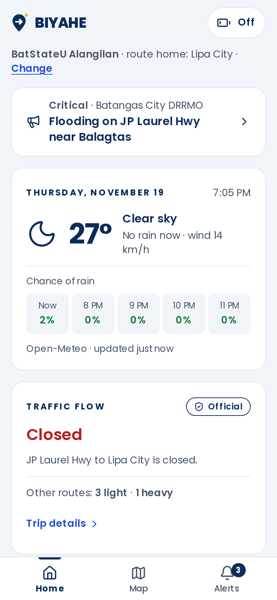
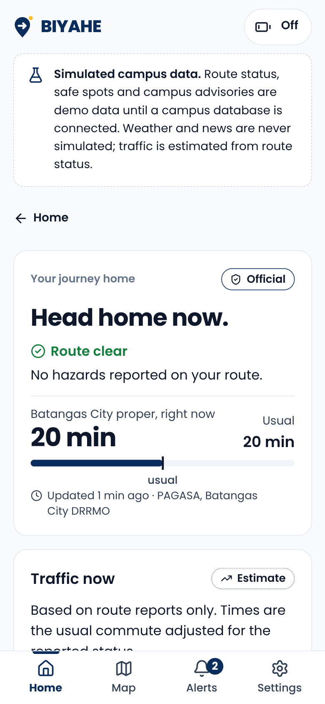
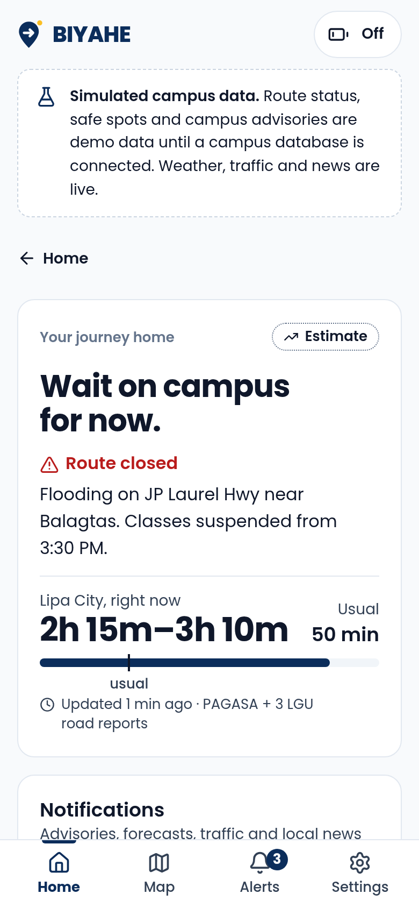
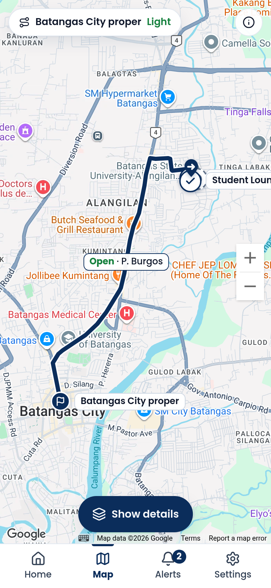
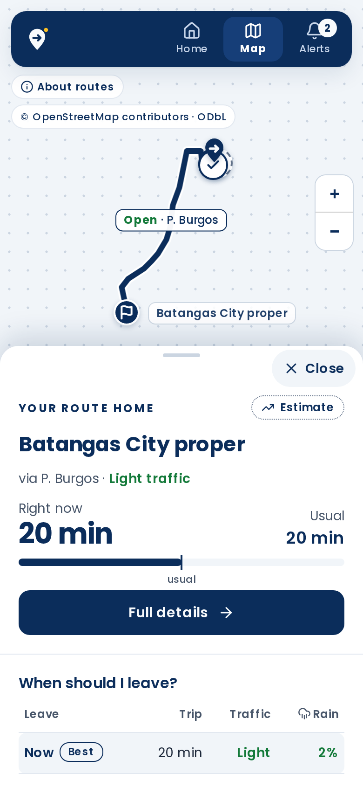
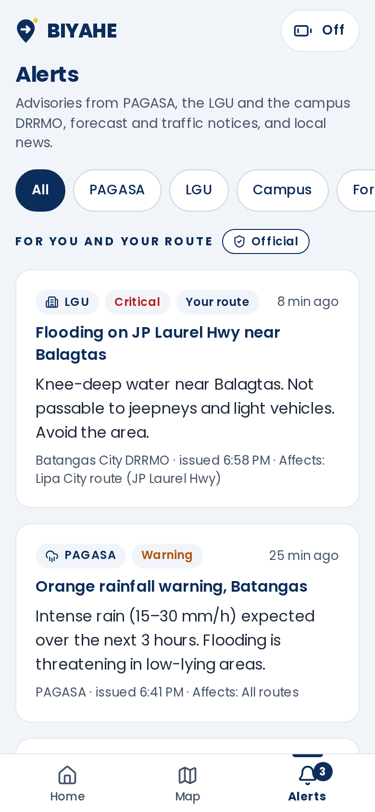
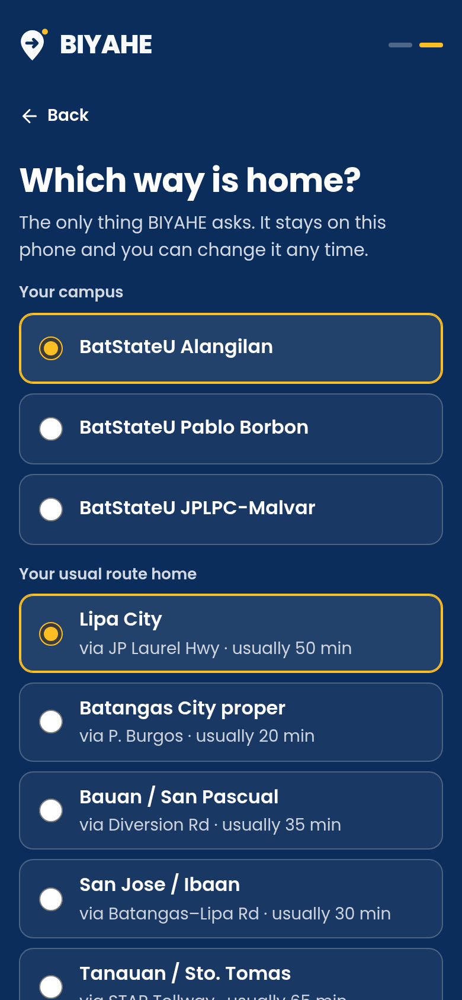
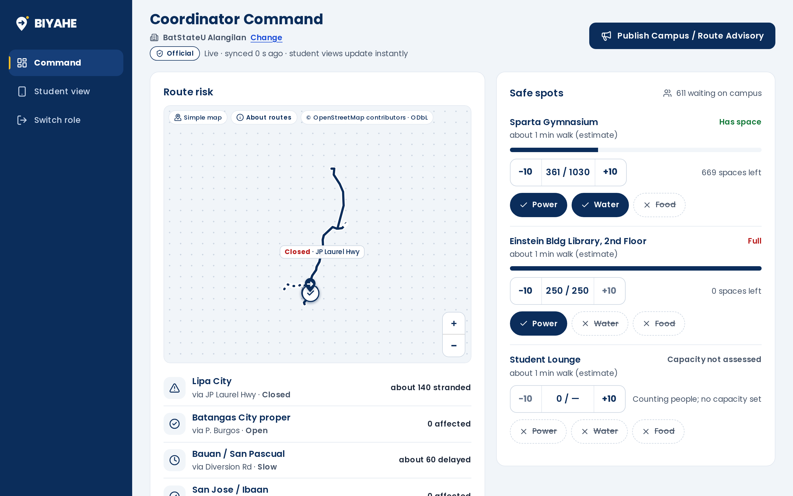

# BIYAHE — Project Documentation

**Safer journeys. Brighter tomorrows.**

*Mas ligtas na paglalakbay para sa mas maraming bukas.*

BeansDev (Team 11) · CS Bootcamp: Build the Way Forward · Iteration 4 · 19 November 2026

---

## 1. Overview

BIYAHE is an offline-first progressive web app (PWA) for commuting students of Batangas State University (Alangilan,
Pablo Borbon and JPLPC-Malvar campuses) and the campus teams who look after them during bad weather and disasters.

**The problem.** When a typhoon, flood or class suspension hits, thousands of students leave campus at once. They do
not know which roads are passable, how long the trip will take, or where to wait safely if they should not leave.
Campus disaster officers (DRRMO) have no quick way to tell them.

**What BIYAHE does.**

| For students (zero input, about ten seconds) | For staff and the DRRMO (three clicks) |
|---|---|
| One clear answer: *Head home now* or *Wait on campus for now*, with travel time against the usual time | Route risk map and estimated stranded students per route (aggregated only, RA 10173) |
| Weather and rain chance for the next hours, traffic flow on their route | Occupancy steppers and amenity toggles for each safe spot |
| Suggested places to go, and every route home and safe spot on campus | Campus advisories with a draft → publish → resolve lifecycle |
| A full-screen map with "When should I leave?" options | Updates reach every open student view immediately |
| Alerts from PAGASA, the LGU, the campus, forecasts, traffic and local news | |
| A pre-written "I'm safe" message for family (share sheet, SMS, copy) | |

The app asks one question (campus and usual route home), keeps no account and tracks no location.

---

## 2. Brand

The visual identity follows the **BIYAHE Brand Guidelines** artboard (team canvas *BIYAHE Logo Concepts*).

**Logo — "Go Pin".** A map pin (where you are, and where to wait safely) holding a forward arrow (know when it is safe
to go), with the rising sun (hope and safer tomorrows) on a Deep Blue tile (trust and institutional strength). The
wordmark is BIYAHE in Poppins ExtraBold; the horizontal lockup can carry the line *People • Places • Safer
tomorrows*. Geometry is copied from the artboard into `src/components/logoGeometry.ts`; the favicon and every PWA icon
are generated from the same values (`npm run icons`). Small sizes use the artboard's favicon tiers (heavier arrow, no
sun below 64 px).

**Palette.**

| Colour | Hex | Role in the app |
|---|---|---|
| Deep Blue | `#0B2D5B` | Headings, primary buttons, navigation rail, routes in focus |
| Sky Blue | `#2563EB` | Links, focus rings, walking routes |
| Sun Yellow | `#FBBF24` | Logo sun, active-tab marker on the rail, the tagline's journey line |
| Cloud White | `#F8FAFC` | Text on Deep Blue |
| Slate Gray | `#64748B` | Secondary lines and routes not in focus |
| Page / lines | `#F1F5F9` / `#E2E8F0` | Page background, card borders |

**The colour rule.** Surfaces are neutral: white cards with a hairline border on a light slate page, with no tinted
panels or coloured highlights. Red, amber and green appear **only as text that reports a level, from low to high**:

| Level | Colour | Used for |
|---|---|---|
| Low | `#147A3A` | Light traffic, route open, rain chance under 30% |
| Medium | `#B45309` | Moderate traffic, route slow, rain 30–59%, warnings |
| High | `#B91C1C` | Heavy traffic, route closed, rain 60% or more, critical advisories, full safe spots |

Status never relies on colour alone: every level has a word, and route lines use a pattern (solid open, dotted
slow, dashed closed). All level colours pass WCAG AA contrast on white.

**Typography.** Poppins (self-hosted): Bold for titles, SemiBold for emphasis, Regular for body text, tabular numbers.
Caveat Brush is used only for the Filipino tagline on the welcome screen. The type scale has clear steps:

| Style | Size | Weight | Use |
|---|---|---|---|
| Display | 28–38 px (fluid) | 700 | The answer on the details page |
| H1 | 22–26 px | 700 | Page titles, traffic level |
| H2 | 18 px | 600 | Card titles |
| H3 / body | 16 px | 600 / 400 | Item titles, paragraphs |
| Meta | 14 px | 400 | Supporting facts |
| Caption | 13 px | 400 | Sources and timestamps |
| Eyebrow | 12 px, tracked caps | 700 | Card labels such as TRAFFIC FLOW |

**Spacing.** One gap between every widget on a page (16 px on phones, 20 px from 900 px) and one padding inside
every card (20 px / 24 px), on an 8-point scale. Tap targets are at least 44–48 px.

---

## 3. User flow


```
Welcome ─► Setup (campus + route home, once)
            │
            ▼
          Home ──► Details (#/go/route/… or #/go/spot/…) ──► Map (#/map/…)
            │            └──► Share "I'm safe"
            ├──► Map (full screen, trip panel)
            └──► Alerts
Staff:  Welcome ─► Staff access ─► Coordinator Command
```

Navigation has three tabs: **Home, Map, Alerts** (bottom bar on phones, Deep Blue side rail from 900 px). The old
Profile page is gone; its campus, route and settings live on the Setup screen, opened from "Change" on Home or the
rail.

### 3.1 Home



Following the wireframe, top to bottom:

1. **Context line** with the campus and route home, and a link to change them.
2. **Urgent alert strip** (only when a critical advisory or one for the student's route is active).
3. **Weather and date**: date, time, current conditions, and the chance of rain for the next five hours (each
   percentage coloured by level).
4. **Traffic flow**: the level on the student's route in large type, the expected trip time against the usual one,
   the source (Live traffic, Estimate or Official), and a one-line summary of the other routes.
5. **Where do you want to go?**: three suggestions. When the route home is open: *Head home* (marked *Best now*),
   *Wait at* the nearest safe spot, and the least-delayed other route. When it is closed: the nearest safe spot with
   room is the recommendation. A closed route is never recommended.
6. **Available places**: every route home (trip time and level) and every safe spot (walk, space left).

Choosing any option or place opens its details.

### 3.2 Details



The answer comes first, as in the wireframe: *Head home now.* / *Expect delays.* / *Wait on campus for now.*, the route
status, the reason, then the travel time right now against the usual time with a bar marking "usual", and when it
was updated and by whom. Below: **Traffic now**, **Notifications** (official advisories, forecast and traffic notices,
local news, each labelled with its source) and **Nearest places to go**. Every place links to its own details. For a
safe spot the page shows the walk, space left, amenities and walking directions. On wide screens the map sits beside
the details.



### 3.3 Map

| Collapsed | Expanded |
|---|---|
|  |  |

The map fills the screen. A single **Options** button at the bottom (tap, or press and hold) opens the navigation bar
on top and the trip panel below, as in the wireframe. The panel holds:

- the destination with trip time now against the usual time, and a link to full details;
- **When should I leave?**: now, in 30 minutes, 1 hour and 2 hours, each with expected trip time, traffic level and
  chance of rain, and the best window marked;
- **Show on the map**: every route and safe spot;
- **Map layers**: all routes, and Google live traffic.

On desktop the panel docks on the left and starts open.


### 3.4 Alerts



One card per advisory with its source and severity as labels (wireframe 5), filters (All, PAGASA, LGU, Campus,
Forecast, News), a section for other routes, forecast and traffic notices worked out by the app (clearly marked as
not official), local news, and advisories that ended in the last few hours.

### 3.5 Setup and settings



Campus and route home, Low-Battery Mode, the demo scenario switcher (Clear, Disrupted, Stale, Offline, Low battery),
data and privacy notes, build information and switching role.

### 3.6 Coordinator Command



Route risk map and list, safe-spot occupancy and amenities, and the advisory lifecycle. Only the DRRMO Coordinator
role can publish; marshals and guards see advisories read-only.

---

## 4. Data sources and APIs

| Source | What it gives | Key | Where it runs | Without it |
|---|---|---|---|---|
| **Google Maps JavaScript API** | The street map, live traffic layer | `VITE_GOOGLE_MAPS_API_KEY` (browser) | Browser | The app's simple map (route lines on a dot grid) |
| **Google Routes API** (computeRoutes) | Traffic-aware and free-flow trip time per route, road geometry that matches the Google map, traffic forecasts for later departures | Same key | Browser (CORS supported) | Times and levels estimated from route reports |
| **Google Weather API** | Current conditions, hourly chance of rain, PAGASA public alerts | `GOOGLE_WEATHER_API_KEY` (server only) | `/api/weather` | "Weather unavailable" (not stored on the device; a failed request is retried after 30 s) |
| **Currents News API** | Local news on floods, traffic, storms and suspensions | `CURRENTS_API_KEY` (server only) | `/api/news` (Vercel Function; Vite middleware locally) | News section says it is off |
| **Supabase** (PostgreSQL + PostGIS + Realtime) | Shared route status, safe spots, advisories across devices | `VITE_SUPABASE_URL`, `VITE_SUPABASE_ANON_KEY` | Browser | Device data + cross-tab sync |
| **OSRM foot router** (FOSSGIS) | Walking route from the campus point to a safe spot | none (`VITE_WALK_ROUTER_URL` optional) | Browser | Saved route, then straight-line estimate |
| **PAGASA / LGU** | Advisory schemas | — | — | Simulated fixtures; no public feed exists |

Notes:

- Official status always wins. A route the DRRMO or LGU marks closed shows *Closed* whatever Google's traffic says,
  and a route reported slow is never shown better than the report. Live traffic can only make a route look worse, or
  give the current figure for an open one.
- Trip times are the route's usual commute time scaled by the live delay (traffic-aware ÷ free-flow duration), so
  they stay comparable with the usual jeepney/bus time instead of showing a private-car time.
- Google route geometry is kept in memory only and is not stored on the device (Google Maps Platform terms). Map
  tiles are never cached by the service worker.
- Google News RSS is **not** used: its terms limit it to personal feed readers.

---

## 5. Setup and configuration

```bash
npm install
cp .env.example .env    # already done in this repository; .env is git-ignored
npm run dev             # http://localhost:5173
```

`.env` holds every key, all optional:

```ini
VITE_GOOGLE_MAPS_API_KEY=     # Maps JavaScript API + Routes API (browser key)
VITE_GOOGLE_MAPS_MAP_ID=      # optional cloud-styled vector map
VITE_GOOGLE_ROUTES_API_KEY=   # optional separate Routes API browser key
CURRENTS_API_KEY=             # server-side only (no VITE_ prefix)
GOOGLE_WEATHER_API_KEY=       # server-side only
GEMINI_API_KEY=               # server-side only, optional
GEMINI_MODEL=                 # optional, default gemini-2.5-flash
VITE_SUPABASE_URL=
VITE_SUPABASE_ANON_KEY=
# VITE_WALK_ROUTER_URL=
```

**Google Maps key.**

1. In Google Cloud Console → APIs & Services, enable **Maps JavaScript API** and **Routes API**.
2. Create an API key. Application restrictions: *Websites* — `http://localhost:5173/*`, `http://localhost:4173/*`
   and your deployed domain. API restrictions: the two APIs above.
3. Put it in `VITE_GOOGLE_MAPS_API_KEY` and restart the dev server. Setup → *About this build* shows "key present".

`VITE_*` values are compiled into the browser bundle and are public by design; protect them with the restrictions
above. `CURRENTS_API_KEY`, `GOOGLE_WEATHER_API_KEY` and `GEMINI_API_KEY` have no `VITE_` prefix, so they stay on the server. `.gitignore` excludes `.env` and every
`.env.*` file except `.env.example`.

**Deploying (Vercel).** Add the same variables under Project → Settings → Environment Variables. `api/news.ts` is
deployed as a Vercel Function; `vercel.json` sends every other path to `index.html`.

---

## 6. Safe spots (waiting areas): verified coordinates

Coordinates are the project owner's values at full precision. Each was checked against OpenStreetMap on
19 November 2026 (Overpass `is_in` and a point-in-polygon test against the building footprint).

| Campus | Safe spot | Latitude | Longitude | OpenStreetMap check |
|---|---|---:|---:|---|
| Alangilan | Student Lounge (formerly CICS Lobby) | 13.78393267903075 | 121.07417575704717 | Inside the campus; between the College of Information and Computing Sciences building and Sparta Gymnasium (both within 35 m). Not inside a mapped building footprint. |
| Alangilan | Sparta Gymnasium | 13.784276340529747 | 121.07413074951742 | Inside "Sparta Gymnasium" (way 489736297) |
| Alangilan | Einstein Bldg Library, 2nd Floor | 13.784168707874697 | 121.0749349027738 | Inside "Albert Einstein Building" (way 454854614) |
| Pablo Borbon | Felistiano "Sanoy" Leviste Multi-Purpose Gymnasium | 13.753079262668649 | 121.05277271784234 | Inside the gymnasium footprint (way 334825726), 14 m from its centre |
| Pablo Borbon | Main Library | 13.754549329790514 | 121.0525887000107 | Inside "Main Library" (way 489731778) |
| JPLPC-Malvar | Gymnasium | 14.044572113490197 | 121.15574880496467 | Inside the campus and inside a building footprint (way 350781586) |

OpenStreetMap names the Pablo Borbon gymnasium *Governor **Feliciano** "Sanoy" Leviste Memorial Multi-Purpose
Gymnasium*; the app keeps the spelling supplied by the project owner until it is confirmed.

Capacity is usable floor area ÷ 2 m² per person; "not assessed" means no source supports a number yet.

---

## 7. Routes home

Each route is a road-following line from the campus to the town it is named after, generated from OpenStreetMap
with OSRM (`npm run routes:campuses`) and validated at runtime.

**Fixed in this iteration.** The Alangilan routes were built from the old hand-drawn corridor ends, so they stopped
3–26 km short of their towns: "Lipa City" ended 3.8 km from campus and "Tanauan / Sto. Tomas" ended near San Jose.
They now reach their destinations:

| Route | Destination | Length | Main roads |
|---|---|---:|---|
| Lipa City | Lipa City Grand Terminal | 25.5 km | President Jose P. Laurel Highway |
| Batangas City proper | Poblacion, P. Burgos Street | 4.5 km | National Highway 4, P. Burgos Street |
| Bauan / San Pascual | Bauan Municipal Hall | 10.6 km | Batangas City–San Pascual–Bauan Bypass Road |
| San Jose / Ibaan | San Jose poblacion | 12.5 km | President Jose P. Laurel Highway |
| Tanauan / Sto. Tomas | Tanauan City Hall | 39.8 km | JP Laurel Highway, STAR Tollway |

The earlier preview is kept only as the record of the reviewed diagnostic run. With a Google key the map draws
Google's own route instead, so the line matches Google's roads exactly. Map labels are placed so they never cover a
pin or another label; a label that has no room is hidden until you zoom in.

---

## 8. Decision rules

| Rule | Value |
|---|---|
| Traffic level from delay (traffic-aware ÷ free-flow) | Light < 1.25 ≤ Moderate < 1.6 ≤ Heavy |
| Live traffic counts as current for | 20 minutes (refreshed every 5 minutes while open) |
| Data marked stale after | 30 minutes |
| Rain level | Low < 30% ≤ Medium < 60% ≤ High |
| Best departure | Least time on the road, with rain counted as risk (+15 min for 30–59%, +40 min for 60%+) and campus waiting counted at a quarter (it is safe) |
| Walking time | Straight-line distance at 75 m per minute, always worded "about" |

---

## 9. Offline and Low-Battery Mode

- The app shell and fonts are precached by the service worker; the last snapshot, weather, news and walking routes
  are kept in IndexedDB. Offline, every screen still works from the saved copy and says so.
- The map switches to the app's simple map (no street tiles), which works with no network.
- Low-Battery Mode (suggested under 20%) uses the simple map, turns off animation and live traffic, and polls half
  as often.

---

## 10. Architecture

React 19 + TypeScript (Vite 8), `vite-plugin-pwa`, Google Maps JavaScript API, Leaflet (simple map only), Supabase,
lucide icons.

| Path | Purpose |
|---|---|
| `src/App.tsx` | Shell, role rules, navigation |
| `src/screens/` | Welcome, Setup, Home, Destination (details), MapScreen, Alerts, Share, StaffAccess, Coordinator |
| `src/components/map/` | `MapView` (chooses the renderer), `GoogleMapView`, `SchematicMap`, pins, label declutter |
| `src/lib/googleRoutes.ts` | Routes API client and polyline decoder |
| `src/lib/traffic.ts` | Traffic levels and departure options |
| `src/lib/places.ts` | Places and recommendations |
| `src/lib/mapModel.ts` | What a map shows, independent of how it is drawn |
| `src/lib/weather.ts`, `src/lib/news.ts`, `src/lib/notices.ts` | Weather, news, derived notices |
| `src/lib/store.ts` | App state, sync, polling |
| `api/news.ts` | `/api/news` (Vercel Function and dev middleware) |
| `src/campuses/` | Campus registry: locations, routes, safe spots |

---

## 11. Quality

- **919 automated tests** (Vitest): domain rules, routing data, recommendations, traffic and departure scoring,
  Routes API parsing, weather and news parsing, map model and label placement, advisory lifecycle, storage migration.
- **Responsive QA**: every screen at 360, 390, 768, 1280 and 1440 px, checked automatically for horizontal overflow,
  overlapping widgets, overlapping map labels and pins, clipped text, tap targets under 40 px, and any red, amber or
  green used as a fill or border. Final run: 0 findings across 75 screen/size combinations.
- `npm run lint` (oxlint) and `npm run build` (type check + production build) pass.

---

## 12. Known limitations

- The street map, live traffic and Google routes need a Google Maps key; until one is set the app uses its simple
  map and estimates. These paths were tested with an invalid key (clean fallback) but not yet against a live key.
- Local news needs a Currents key; without it the app shows advisories and its own notices only.
- PAGASA and LGU advisories are simulated: neither offers a public feed.
- Walking routes start from the campus point, not the student's position (the app does not track location).
- Route lines and safe-spot positions are map-derived and not checked on site; the map's *About routes* button says so.
- The demo Supabase policies allow open writes; put them behind staff authentication before real use.

---

## 13. Credits

Map data © OpenStreetMap contributors (ODbL) for route lines and walking paths; Google Maps Platform for the street
map, traffic and Google routes; weather by the Google Weather API; news powered by Currents News API; icons by Lucide (ISC); Poppins and Caveat Brush
(SIL Open Font License).
